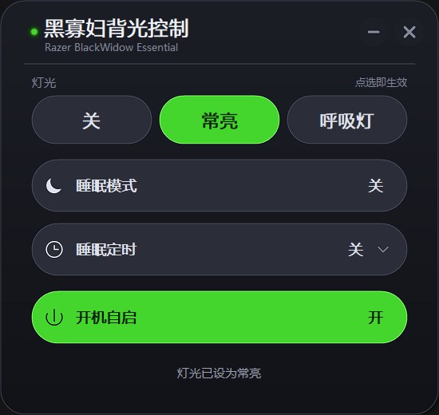
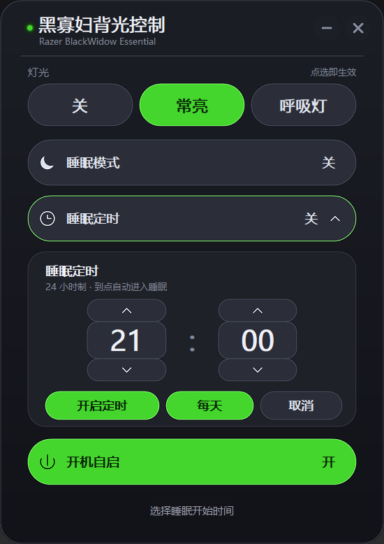

# 黑寡妇背光控制（BWEssential Static Backlight）

一个针对 **Razer BlackWidow Essential（黑寡妇 Essential）** 的轻量背光控制面板。用 `hidapi` 直接向键盘发送 Razer 协议报文，把出厂默认的呼吸灯切成常亮，**不需要安装 Razer Synapse**。

纯 C + Win32 实现，无第三方界面库；单文件 exe，窗口、圆角、按钮和文字全部自绘。

> 设备匹配：VID `0x1532` / PID `0x0237`，usage page `0x01`、usage `0x02`、interface `2`






> 截图拍摄于早期版本，当前版本已将「开机自启」从主界面移到设置页。

## 功能

- **三态灯光**：关 / 常亮 / 呼吸灯，点选立即生效，选中胶囊用雷蛇绿高亮。
- **启动读回真实状态**：打开面板时先发一帧 get effect，显示键盘当前灯效，而不是假定的状态。
- **睡眠模式**：一键关灯并锁定灯光按钮；退出睡眠时恢复之前选的灯效。
- **睡眠定时**：24 小时制时 / 分选择，支持单次或每天重复，到点自动进入睡眠。
- **设置页**：最小化至托盘、关闭时最小化、开机自启三个开关，修改立即保存。
- **系统托盘**：隐藏后左键恢复窗口，右键菜单可「打开面板 / 退出」。
- **单实例**：重复双击 exe 只把已有窗口唤到最前，不会多开。
- **原生渲染**：无边框圆角深色窗口，2 倍超采样 DIB，按系统 DPI 缩放，悬停只重绘变化的控件。

## 界面与操作

| 控件 | 作用 |
| --- | --- |
| 关 / 常亮 / 呼吸灯 | 三颗胶囊按钮，点哪个立即生效 |
| 睡眠模式：开 / 关 | 开启后灯光按钮变灰锁定、灯光关闭；关闭后恢复之前选的灯光 |
| 睡眠定时 | 展开 24 小时制时 / 分选择；「每天」切换是否每天重复 |
| 设置（标题栏「设置」/ 齿轮） | 进入设置页，左上角返回箭头或 `Esc` 退回 |

- 灯光是「点选」而不是循环切换，当前状态直接高亮。
- 睡眠模式只锁灯光；睡眠定时和设置页仍然可以操作。
- 睡眠定时只负责「进入睡眠」，不会自动退出睡眠；已经在睡眠模式时到点不会重复操作。
- 关闭「每天」时定时只执行一次，触发后自动关闭；打开「每天」时触发后顺延到第二天同一时间，胶囊显示「每天 HH:MM」。
- 手动退出睡眠不会取消已经开着的定时；不想再定时就在面板里点「关闭定时」。
- 定时依赖面板进程运行；程序退出后不会执行。定时设置会保存在注册表，下次打开时如果时间还没到会继续生效。
- 右上角 `—` 最小化，`×` 关闭；拖动标题栏可以移动窗口。
- `Esc` 的优先级：设置页 → 退回主界面；定时面板展开 → 收起面板；都不是 → 按「关闭时最小化」设置执行关闭。

## 设置页

设置页不是独立窗口，而是在同一个无边框窗口里切换视图并调整高度（`440 × 400`，96 DPI 逻辑像素）。

| 开关 | 默认 | 行为 | 注册表值 |
| --- | --- | --- | --- |
| 最小化至托盘 | 开 | 点 `—` 或系统菜单最小化时隐藏到通知区域，不占任务栏；关闭后恢复普通最小化 | `MinimizeToTray` |
| 关闭时最小化 | 关 | 点 `×`、`Esc` 或 `Alt+F4` 时隐藏到托盘而不是退出；关闭后关闭即退出程序 | `CloseToTray` |
| 开机自启 | 关 | 写入 / 删除登录启动项；开启后登录 Windows 时以 `--silent` 启动并切换为常亮 | `Run\BWEssentialBacklight` |

所有设置保存在 `HKCU\Software\BWEssentialBacklight`，修改后立刻写入；开机自启写入 `HKCU\Software\Microsoft\Windows\CurrentVersion\Run`。

> 「关闭时最小化」只影响关闭动作；要从托盘真正退出，请用托盘右键菜单的「退出」。

## 直接运行

1. 把 [BWBacklight.exe](BWBacklight.exe) 和 [libhidapi-0.dll](libhidapi-0.dll) 放在同一目录（仓库里已经放好）。
2. 连接键盘，双击 exe。

DLL 文件名必须和 exe 里记录的导入名完全一致，不能改名互换：当前 [BWBacklight.exe](BWBacklight.exe) 只认 `libhidapi-0.dll`，缺失时会提示「由于找不到 libhidapi-0.dll，无法继续执行代码」。

如果键盘完全不亮，先按 `Fn+F12` 把键盘自身亮度调到最高；程序每次切灯效前也会先发一帧 100% 亮度。

## 编译

需要 MSYS2 x64（提供 `gcc`、`windres`）以及 hidapi 的头文件和库：

```sh
pacman -S mingw-w64-ucrt-x86_64-hidapi
```

然后：

```sh
make gui
```

等价于：

```sh
windres app.rc -o app_res.o
gcc gui.c app_res.o -lhidapi -lgdi32 -luser32 -ladvapi32 -lshell32 -lmsimg32 -mwindows -o BWBacklight.exe
```

- `-mwindows`：不弹控制台窗口
- `-lmsimg32`：窗口渐变
- `-lshell32`：托盘图标

其他目标：

```sh
make main   # 只编译上游命令行版 main.exe
make all    # 同时编译 main.exe 与 BWBacklight.exe
make clean  # 删除编译产物
```

编译出的 exe 需要同目录的 `libhidapi-0.dll`。本机可以从 MSYS2 复制：

```sh
cp /ucrt64/bin/libhidapi-0.dll .
```

### 应用图标

exe 图标来自 [razer.png](razer.png)：

- [app.ico](app.ico) 是 16 / 24 / 32 / 48 / 64 / 128 / 256 七个尺寸的多尺寸图标（小尺寸为 32bpp DIB，64 以上为 PNG 帧）。
- [app.rc](app.rc) 把它编成图标组 ID `1`，由 `windres` 生成 `app_res.o` 一起链接，作为资源管理器显示的 exe 文件图标。
- 窗口和任务栏图标使用同一个 ID：`gui.c` 里的 `LoadIconW(inst, MAKEINTRESOURCEW(APP_ICON_ID))`，取不到时退回系统默认图标。

修改图标：

```sh
pwsh tools\make-ico.ps1   # razer.png -> app.ico（7 个尺寸，输出确定）
make gui
```

## 实现说明

### 界面渲染

- `WS_POPUP` 无边框窗口，用 `SetWindowRgn` + `CreateRoundRectRgn` 做圆角。
- 深色渐变背景、雷蛇绿选中态；三颗胶囊灯光按钮、睡眠 / 定时两条设置行，设置页三条开关行。
- 睡眠定时面板展开、进出设置页时窗口动态调整高度，窗口区域和背景 DIB 一起重建。
- 2 倍超采样 DIB + `StretchBlt(HALFTONE)`，在边缘平滑和内存占用之间取平衡。
- 悬停变化只失效旧 / 新控件矩形，绘制时只拷贝 `ps.rcPaint` 区域，快速移动鼠标不会整窗重绘闪烁。
- 文字使用微软雅黑，按系统 DPI 缩放；窗口逻辑尺寸以 96 DPI 为基准。

### 单实例

启动时用 `CreateMutexW(Local\\...)` 创建命名互斥量：

- 第一个实例正常建窗口。
- 再次启动时若互斥量已存在，用 `FindWindowW` 找到原窗口，`ShowWindow(SW_RESTORE)` + `SetForegroundWindow`，然后自己退出。
- `--silent` 同样受互斥量约束：如果已有实例在跑，直接退出，不会多开。

### 定时与持久化

- 每秒检查一次 `g_next_fire`，到点后进入睡眠并发送关灯报文。
- 单次定时触发后清空；每天定时触发后重新计算下一次，写入注册表。
- 程序关闭期间错过每天定时：下次启动会把时间顺延到同一时刻的下一天；单次定时错过则丢弃。
- 进程运行中因系统休眠等原因错过触发超过 120 秒时，不会补执行，只在状态栏提示。

### 托盘

- `Shell_NotifyIconW(NIM_ADD/NIM_DELETE)` 管理通知区域图标，回调消息为 `WM_APP + 1`。
- 图标只在窗口隐藏时存在；窗口重新显示（包括被单实例逻辑唤起）时会移除图标。
- 左键单击 / 双击恢复窗口，右键弹出「打开面板 / 退出」菜单。

## 设备协议

### 三种灯光状态

使用 Razer 的 set effect 命令（class `0x0F` / cmd `0x02`），参数第 0 字节是 VARSTORE，第 1 字节是 BACKLIGHT_LED：

| 状态 | 参数 | 说明 |
| --- | --- | --- |
| 关 | `01 05 00 00 00 00` | none |
| 常亮 | `01 05 01 00 00 01 00 FF 00` | static，绿色 |
| 呼吸灯 | `01 05 02 01 00 01 00 FF 00` | breathing single，绿色 |

每次切换前先发一帧亮度 100%：class `0x0F` / cmd `0x04` / 参数 `01 05 FF`。

报文第 89 字节是校验：`report[89] = XOR(report[3..88])`；data size 写在第 6 字节；实际发送 91 字节。实测这些命令键盘都返回 `0x02`，读回的 effect 依次是 `0x00` / `0x01` / `0x02`。

### 启动读取

发一帧 get effect（class `0x0F` / cmd `0x82` / 参数 `01 05`），读回 response 的 `arguments[2]`：

- `0x00` → 关
- `0x01` → 常亮
- `0x02` → 呼吸灯
- 其他 → 常亮

## 项目结构

| 文件 | 说明 |
| --- | --- |
| [gui.c](gui.c) | 图形界面全部逻辑：窗口、自绘、HID、托盘、定时、注册表 |
| [main.c](main.c) / [main.h](main.h) | 上游命令行程序；`main.h` 同时提供设备常量与报文模板 |
| [makefile](makefile) | `main` / `gui` / `all` / `clean` 构建目标 |
| [app.rc](app.rc) / [app.ico](app.ico) / [razer.png](razer.png) | 图标资源及源图 |
| [tools/make-ico.ps1](tools/make-ico.ps1) | 由 `razer.png` 生成 `app.ico` |
| [BWBacklight.exe](BWBacklight.exe) | 已编译的图形界面程序 |
| [libhidapi-0.dll](libhidapi-0.dll) | 当前 exe 依赖的 hidapi 0.15 运行库 |
| [BWBacklight - 副本.exe](<BWBacklight - 副本.exe>) / [hidapi.dll](hidapi.dll) | 加入设置页之前的旧版程序及其 hidapi 0.14 运行库，仅用于回退 |
| `ui*.png` | 界面截图 |

## 相对上游的变化

本项目是 [Tommy-Sand/BWEssential-Static-Backlight](https://github.com/Tommy-Sand/BWEssential-Static-Backlight) 的二次开发分支。

上游（2022 年，commit `05278ff`）用 `hidapi` 在命令行把背光从呼吸切到常亮，源码为 `main.c` / `main.h` / `makefile`，没有界面和状态持久化。本仓库保留其设备枚举方式与 Razer `0x0F` 报文（set / get effect、亮度、91 字节 XOR 校验），并重写了交互层。

| 层面 | 上游 | 本仓库 |
| --- | --- | --- |
| 交互方式 | 命令行，跑一次切一次 | 深色圆角图形界面，点选即生效 |
| 灯光模式 | 仅「关 / 常亮」 | 关 / 常亮 / 呼吸灯三态，启动读回真实状态 |
| 状态持久 | 无 | 定时与托盘开关存注册表；灯效状态由键盘保存 |
| 睡眠模式 | 无 | 一键关灯锁定 + 24 小时制定时入睡（支持每天重复） |
| 托盘与自启 | 无 | 最小化 / 关闭到托盘、托盘菜单、开机自启 |
| 运行约束 | 可多开 | 单实例互斥，后启动的只把前台实例唤到最前 |
| 编译产物 | `main.exe` | `BWBacklight.exe`（`-mwindows`，2 倍超采样渲染） |

协议层语义未改动，只扩展了调用时机与状态机。

## 许可证与致谢

设备枚举和 Razer 协议细节来自上游项目 [Tommy-Sand/BWEssential-Static-Backlight](https://github.com/Tommy-Sand/BWEssential-Static-Backlight)，感谢原作者。本仓库沿用上游的许可证；当前仓库尚未附带 `LICENSE` 文件，分发前请以原仓库的许可证声明为准。
