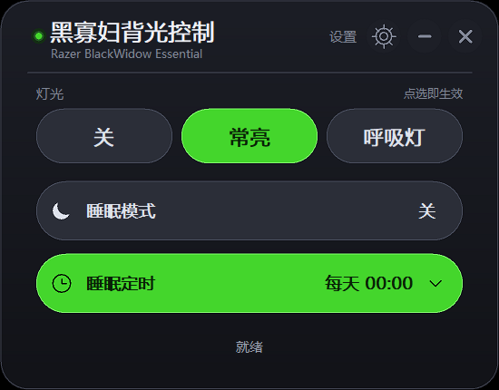
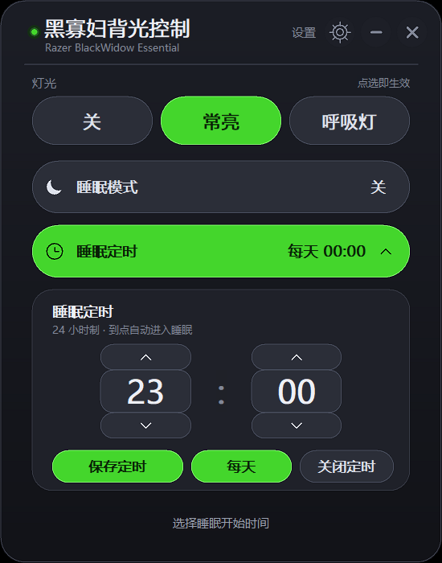
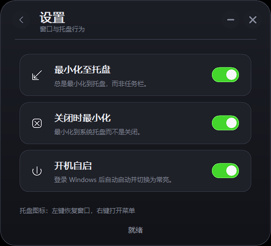
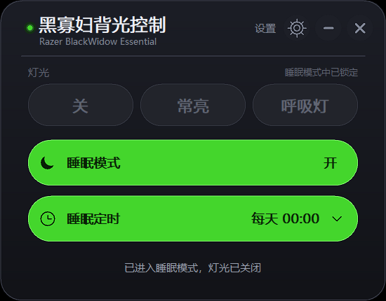

# 黑寡妇背光控制 · Razer BlackWidow Essential 背光面板

不装 Razer Synapse，也能把 **Razer BlackWidow Essential（黑寡妇 Essential）** 的背光从出厂默认的呼吸灯切成常亮。

程序通过 `hidapi` 直接向键盘发送 Razer 私有报文，纯 C + Win32 实现，没有第三方界面库：单个 exe 加一个 hidapi 运行库即可运行，窗口、圆角、按钮、开关和文字全部自绘。

> 匹配设备：VID `0x1532`、PID `0x0237`、usage page `0x01`、usage `0x02`、interface `2`

## 界面预览

**主界面**



**睡眠定时面板**



**设置页**



**睡眠模式（灯光已锁定）**



## 功能一览

| 功能 | 说明 |
| --- | --- |
| 三态灯光 | 关 / 常亮 / 呼吸灯，点哪个立即生效，选中项用雷蛇绿高亮 |
| 状态读回 | 启动时发一帧 get effect，显示键盘真实灯效而不是假定值 |
| 睡眠模式 | 一键关灯并锁定三颗灯光按钮，再点一次恢复之前选的灯效 |
| 睡眠定时 | 24 小时制时 / 分选择，支持单次或每天重复，到点自动进入睡眠 |
| 设置页 | 最小化至托盘、关闭时最小化、开机自启三个开关，改动立即写注册表 |
| 系统托盘 | 隐藏到通知区域后左键恢复窗口，右键菜单「打开面板 / 退出」 |
| 单实例 | 重复启动只把已有窗口唤到最前，不会多开 |
| 原生渲染 | 无边框圆角深色窗口，2 倍超采样 DIB，悬停只重绘变化的控件 |

## 快速开始

1. 把 [BWBacklight.exe](BWBacklight.exe) 和 [libhidapi-0.dll](libhidapi-0.dll) 放在同一个目录（仓库里已经放好）。
2. 插上键盘，双击 exe。
3. 点「常亮」，背光立刻从呼吸变成常亮；想每次登录都自动启动并常亮，就在「设置」里打开「开机自启」。

程序不需要管理员权限，也不会安装任何服务或驱动。

## 使用说明

### 灯光

- 三颗胶囊是**点选**，不是循环切换；当前灯效直接高亮，点已选中的项会原样重发一次报文。
- 每次切换前都会先发一帧亮度 100%，避免键盘自身亮度为 0 时看起来「没反应」。
- 状态栏会回显结果：`灯光已设为常亮` / `灯光已设为呼吸灯` / `灯光已关闭`；找不到设备时提示 `没找到键盘，请检查连接`。

### 睡眠模式

- 开启后灯光关闭，三颗胶囊变灰锁定，右侧标签显示「睡眠模式中，灯光已锁定」。
- 再次点击退出睡眠，恢复进入之前选中的灯效。
- 睡眠模式只锁灯光，睡眠定时和设置页仍可正常操作。

### 睡眠定时

- 点「睡眠定时」行展开面板，用上下箭头调时 / 分（24 小时制）。
- 「每天」决定是每天重复还是只执行一次；按钮上显示的是**待保存**的选择，点「保存定时 / 开启定时」后才生效。
- 生效后胶囊显示 `HH:MM` 或 `每天 HH:MM`；已开启时按钮文案变成「保存定时 / 关闭定时」。
- 单次定时触发后自动关闭；每天定时触发后顺延到第二天同一时间。
- 到点只会**进入**睡眠模式，不会自动退出；如果触发时已经在睡眠模式，则不做重复操作。
- 手动退出睡眠不会取消已开启的定时；不想再定时要在面板里点「关闭定时」。
- 定时依赖进程存活：程序退出后不会执行。下一次触发时间会写进注册表，重新打开时如果还没到点会继续生效。
- 程序运行期间错过触发（例如系统休眠唤醒）超过 120 秒不会补执行，只在状态栏提示；关机期间错过的「每天」定时，下次启动会自动顺延到同一时刻的下一天。

### 窗口操作

- 右上角 `—` 最小化、`×` 关闭，拖动标题栏移动窗口。
- `Esc` 的优先级：设置页 → 退回主界面；定时面板展开 → 收起面板；两者都不是 → 执行关闭（是否进托盘取决于「关闭时最小化」）。
- 单实例：已经打开时再双击 exe，只会把原窗口唤到最前，不会新增窗口。

### 设置页

点标题栏右侧的「设置」或齿轮进入，左上角返回箭头或 `Esc` 退回。设置页不是独立窗口，而是同一个无边框窗口切换视图并调整高度。

| 开关 | 默认 | 行为 |
| --- | --- | --- |
| 最小化至托盘 | 开 | 点 `—` 或系统菜单最小化时隐藏到通知区域，不占任务栏；关闭后恢复普通最小化 |
| 关闭时最小化 | 关 | 点 `×`、`Esc` 或 `Alt+F4` 时隐藏到托盘而不是退出；关闭后关闭即退出程序 |
| 开机自启 | 关 | 写入 / 删除登录启动项；开启后登录 Windows 时自动启动面板（隐藏到托盘）并把背光切到常亮 |

- 「关闭时最小化」只影响关闭动作。要真正退出程序，用托盘右键菜单的「退出」，退出前会先把托盘图标移除。
- 开机自启写入后立即回读校验，失败时状态栏提示 `注册表写入失败`。
- 登录自启使用 `--autostart`：窗口创建后直接隐藏到托盘，不弹窗、不抢焦点，所以登录后看到的是通知区域图标，而不是主界面。
- 登录时如果键盘还没枚举完成，程序会在后台每秒重试一次（最多 20 秒），连上后再切换为常亮，因此不会出现「开机自启没生效」。
- 旧版本写入的 `--silent` 启动项会在下一次运行时自动迁移成 `--autostart`；`--silent` 仍然保留为「只发一次常亮报文就退出」的一次性模式。
- 自启实例同样受单实例约束：如果面板已经在运行，登录时的 `--autostart` 会安静退出，不会多开，也不会抢前台。

### 托盘

- 只有窗口被隐藏到托盘时图标才存在；窗口重新显示（包括被单实例逻辑唤起）会自动移除图标。
- 左键单击 / 双击恢复窗口，右键弹出「打开面板 / 退出」。
- 提示文字为窗口标题「黑寡妇背光控制」。

## 编译

需要 MSYS2 x64（提供 `gcc`、`windres`、`make`）和 hidapi 开发包：

```sh
pacman -S mingw-w64-ucrt-x86_64-hidapi
```

构建 GUI：

```sh
make gui
```

等价于：

```sh
windres app.rc -o app_res.o
gcc gui.c app_res.o -lhidapi -lgdi32 -luser32 -ladvapi32 -lshell32 -lmsimg32 -mwindows -o BWBacklight.exe
```

- `-mwindows`：不弹控制台窗口
- `-lmsimg32`：背景渐变用的 `AlphaBlend`
- `-lshell32`：托盘图标用的 `Shell_NotifyIconW`

其他目标：

```sh
make main   # 上游命令行版 main.exe
make all    # main.exe + BWBacklight.exe
make clean  # 清理产物
```

产物需要同目录的 `libhidapi-0.dll`（hidapi 0.15）。本机可以直接从 MSYS2 复制：

```sh
cp /ucrt64/bin/libhidapi-0.dll .
```

DLL 的**文件名必须和 exe 记录的导入名一致**，不能改名互换：`make gui` 产出的 exe 认 `libhidapi-0.dll`；仓库里的旧版 `BWBacklight - 副本.exe` 认 [hidapi.dll](hidapi.dll)（hidapi 0.14）。放错会报「由于找不到 xxx.dll，无法继续执行代码」。

### 应用图标

exe 图标来自 [razer.png](razer.png)：

- [app.ico](app.ico) 是 16 / 24 / 32 / 48 / 64 / 128 / 256 七个尺寸的多尺寸图标（小尺寸为 32bpp DIB，64 以上为 PNG 帧）。
- [app.rc](app.rc) 把它编成图标组 ID `1`，`windres` 生成 `app_res.o` 一起链接，即资源管理器里看到的 exe 文件图标。
- 窗口、任务栏和托盘图标复用同一个 ID：`LoadIconW(inst, MAKEINTRESOURCEW(APP_ICON_ID))`，取不到时退回系统默认图标。

换图标：替换 `razer.png` 后重新生成并编译。

```sh
pwsh tools\make-ico.ps1   # razer.png -> app.ico（7 个尺寸，输出确定）
make gui
```

## 工作原理

### 设备与报文

灯光用 Razer 的 set effect 命令（class `0x0F` / cmd `0x02`），参数第 0 字节是 VARSTORE，第 1 字节是 BACKLIGHT_LED：

| 状态 | 参数 | 说明 |
| --- | --- | --- |
| 关 | `01 05 00 00 00 00` | none |
| 常亮 | `01 05 01 00 00 01 00 FF 00` | static，绿色 |
| 呼吸灯 | `01 05 02 01 00 01 00 FF 00` | breathing single，绿色 |

- 每次切换前先发一帧亮度 100%：class `0x0F` / cmd `0x04` / 参数 `01 05 FF`。
- 报文共 91 字节，data size 写在第 6 字节，第 89 字节是校验：`report[89] = XOR(report[3..88])`。
- 实测这些命令键盘都返回 `0x02`，读回的 effect 依次是 `0x00` / `0x01` / `0x02`。

启动读取：发一帧 get effect（class `0x0F` / cmd `0x82` / 参数 `01 05`），读回 response 的 `arguments[2]`：`0x00` → 关，`0x01` → 常亮，`0x02` → 呼吸灯，其他 → 常亮。

### 渲染

- `WS_POPUP` 无边框窗口 + `SetWindowRgn` / `CreateRoundRectRgn` 做圆角，`CS_DROPSHADOW` 加投影。
- 背景、渐变、胶囊和开关画在一张 **2 倍超采样的 DIB** 上，再用 `StretchBlt(HALFTONE)` 拷回屏幕，兼顾边缘平滑和内存占用（125% 缩放下 DIB 约 3.8 MB，进程私有内存约 10 MB；改成 4 倍超采样时同一张 DIB 约 15 MB、进程约 21 MB）。
- 文字按原生分辨率直接绘在屏幕 DC 上，避免二次缩放导致发虚；字体为 Microsoft YaHei UI。
- 悬停状态变化只让旧 / 新控件矩形失效（外扩 2 px 消除画笔边缘残影），绘制时只拷贝 `ps.rcPaint` 区域，快速滑动鼠标不再整窗重绘。
- 逻辑布局以 96 DPI 为基准（主界面 `440×344`、定时展开 `440×560`、设置页 `440×400`），启动时 `SetProcessDPIAware()` 并按主屏 DPI 缩放。窗口位于缩放比例与主屏不同的副屏时，Windows 会做位图拉伸，边缘可能略微发虚。

### 状态存储

灯效本身存在键盘里，程序不额外保存；界面状态和设置存在注册表：

| 位置 | 值名 | 类型 | 含义 |
| --- | --- | --- | --- |
| `HKCU\Software\BWEssentialBacklight` | `SleepTimerNext` | `REG_QWORD` | 下次触发的 Unix 时间戳，`0` 表示未开启 |
| 同上 | `SleepTimerDaily` | `REG_DWORD` | 是否每天重复 |
| 同上 | `MinimizeToTray` | `REG_DWORD` | 最小化至托盘，缺省 `1` |
| 同上 | `CloseToTray` | `REG_DWORD` | 关闭时最小化，缺省 `0` |
| `HKCU\Software\Microsoft\Windows\CurrentVersion\Run` | `BWEssentialBacklight` | `REG_SZ` | `"<exe 完整路径>" --autostart` |

想恢复出厂呼吸灯：打开面板点「呼吸灯」即可；想清掉所有设置：删除 `HKCU\Software\BWEssentialBacklight` 这一项。

### 单实例与定时调度

- 启动时 `CreateMutexW(L"Local\\BWBacklightPanel_9C3F2A7E_V3")`；若互斥量已存在，普通启动会用 `FindWindowW` 找到原窗口并 `ShowWindow` + `SetForegroundWindow` + `FlashWindow`，自己退出；`--silent` 和 `--autostart` 则安静退出。
- 窗口过程里 `SetTimer` 每秒检查一次 `g_next_fire`，到点执行触发逻辑；因此程序最小化到托盘、或由登录自启隐藏在托盘时，定时依然有效。
- 登录自启时窗口从不显示，托盘图标就是运行中的标志；点托盘图标才会把主界面叫出来。

## 常见问题

| 现象 | 处理 |
| --- | --- |
| 键盘完全不亮 | 先按 `Fn+F12` 把键盘自身亮度调到最高；程序每次切灯效前也会补发一帧 100% 亮度 |
| 状态栏提示「没找到键盘，请检查连接」 | 确认型号是 BlackWidow Essential、换 USB 口、拔掉其他 Razer 设备试试；若装了 Synapse 之类会独占 HID 的软件，先退出 |
| 启动报缺少 DLL | 把对应版本的 hidapi 运行库放到 exe 同目录，文件名不能改（见「编译」一节） |
| 定时没有触发 | 定时需要进程存活；确认状态栏胶囊显示的是时间而不是「关」，且程序没有被「退出」掉 |
| 登录后没看到程序 | 自启会隐藏到托盘，看通知区域（点任务栏的「^」展开）；主界面不会自动弹出 |
| 开机自启没生效 | 确认设置页开关是「开」、任务管理器「启动应用」里没有被禁用；程序启动时会自动把旧的 `--silent` 值迁移成 `--autostart` |
| 找不到窗口 | 可能已最小化到托盘，点托盘图标恢复；托盘图标只在隐藏时存在 |
| 想彻底关掉程序 | 关闭「关闭时最小化」后点 `×`，或右键托盘图标选「退出」 |

## 项目结构

| 文件 | 说明 |
| --- | --- |
| [gui.c](gui.c) | 图形界面全部逻辑：窗口、自绘、HID、托盘、定时、注册表（约 2250 行单文件） |
| [main.c](main.c) / [main.h](main.h) | 上游命令行程序；`main.h` 同时提供设备常量与常亮报文模板 |
| [makefile](makefile) | `main` / `gui` / `all` / `clean` 构建目标 |
| [app.rc](app.rc) / [app.ico](app.ico) / [razer.png](razer.png) | 图标资源及源图 |
| [tools/make-ico.ps1](tools/make-ico.ps1) | 由 `razer.png` 生成 `app.ico` |
| [BWBacklight.exe](BWBacklight.exe) | 当前编译好的图形界面程序 |
| [libhidapi-0.dll](libhidapi-0.dll) | 当前 exe 依赖的 hidapi 0.15 运行库 |
| [BWBacklight - 副本.exe](<BWBacklight - 副本.exe>) / [hidapi.dll](hidapi.dll) | 加入设置页之前的旧版程序及其 hidapi 0.14 运行库，仅用于回退 |
| `ui.png` `ui_timer.png` `ui_settings.png` `ui_sleep.png` | 界面截图 |

## 与上游的差异

本项目基于 [Tommy-Sand/BWEssential-Static-Backlight](https://github.com/Tommy-Sand/BWEssential-Static-Backlight)（2022 年，commit `05278ff`）二次开发。上游用 `hidapi` 在命令行把背光从呼吸切到常亮，源码只有 `main.c` / `main.h` / `makefile`，没有界面和状态持久化。本仓库保留其设备枚举方式与 Razer `0x0F` 报文（set / get effect、亮度、91 字节 XOR 校验），协议语义未改动，只扩展了调用时机与状态机。

| 层面 | 上游 | 本仓库 |
| --- | --- | --- |
| 交互方式 | 命令行，跑一次切一次 | 深色圆角图形界面，点选即生效 |
| 灯光模式 | 仅「关 / 常亮」 | 关 / 常亮 / 呼吸灯三态，启动读回真实状态 |
| 状态持久 | 无 | 定时与托盘开关存注册表，灯效状态由键盘保存 |
| 睡眠模式 | 无 | 一键关灯锁定 + 24 小时制定时入睡（支持每天重复） |
| 托盘与自启 | 无 | 最小化 / 关闭到托盘、托盘菜单、开机自启 |
| 运行约束 | 可多开 | 单实例互斥，后启动的只把前台实例唤到最前 |
| 编译产物 | `main.exe` | `BWBacklight.exe`（`-mwindows`，2 倍超采样渲染） |

## 许可与致谢

设备枚举方式和 Razer 协议细节来自上游项目 [Tommy-Sand/BWEssential-Static-Backlight](https://github.com/Tommy-Sand/BWEssential-Static-Backlight)，感谢原作者。本仓库沿用上游的许可证；当前仓库尚未附带 `LICENSE` 文件，分发前请以原仓库的许可证声明为准。
