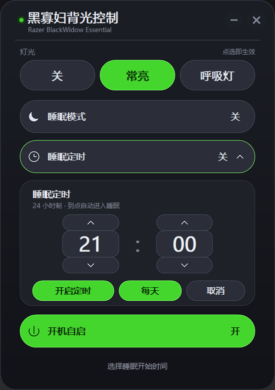

This program is for the Razer BlackWidow Essential keyboard. It uses the hidapi to change the rgb from breathing to static without the use of Razer Synapse. This program is made on Mysys2 x64. Make sure you have hidapi installed before running make

## 图形界面版（gui.c / BWBacklight.exe）

深色无边框窗口，圆角，三颗胶囊灯光按钮 + 睡眠模式 + 睡眠定时：





| 控件 | 作用 |
| --- | --- |
| 关 / 常亮 / 呼吸灯 | 三颗胶囊按钮，点哪个立即生效；选中的胶囊是雷蛇绿 |
| 睡眠模式：开 / 关 | 开启后三颗灯光胶囊变灰锁定，灯光关闭；关闭后恢复之前选的灯光 |
| 睡眠定时 | 展开 24 小时制时/分选择；「每天」切换是否每天重复 |
| 开机自启：开 / 关 | 写入 / 删除 `HKCU\Software\Microsoft\Windows\CurrentVersion\Run` |

- 灯光胶囊是「点选」而不是循环切换；当前状态直接高亮。
- 睡眠模式只锁灯光，睡眠定时和开机自启仍然可以操作。
- 睡眠定时只负责「进入睡眠」，不会自动退出睡眠；如果已经在睡眠模式，到点不会重复操作。
- 关闭「每天」时定时只执行一次，触发后自动关闭；打开「每天」时触发后会排到下一天的同一时间，胶囊显示「每天 HH:MM」。
- 手动退出睡眠不会取消已经开着的定时；不想再定时就在面板里点「关闭定时」。
- 定时需要面板保持运行；程序关掉时不会执行。定时设置会保存在注册表，下次打开时如果时间还没到会继续生效。
- 打开窗口时会读一次键盘当前灯效，所以第一次显示的就是真实状态。
- 右上角 `—` 最小化，`×` 关闭；拖动标题栏可以移动；`Esc` 在定时面板展开时先收起面板，再按一次才关闭程序。
- 单实例：已经打开时再双击 exe 不会新增第二个窗口，只会把原窗口叫到最前面。

### 直接运行

把 [BWBacklight.exe](BWBacklight.exe) 和 [hidapi.dll](hidapi.dll) 放在同一目录，双击 exe。[hidapi.dll](hidapi.dll) 仓库里已经放好。

### 编译

```sh
make gui
```

等价于：

```sh
gcc gui.c -lhidapi -lgdi32 -luser32 -ladvapi32 -lmsimg32 -mwindows -o BWBacklight.exe
```

需要和 main.c 相同的环境（MSYS2 x64 + hidapi）。`-mwindows` 表示不弹控制台窗口，`-lmsimg32` 是窗口渐变用的。

注意 dll 依赖：

- 仓库里预编译的 [BWBacklight.exe](BWBacklight.exe) 是用 hidapi 官方 Windows 构建链接的，依赖 [hidapi.dll](hidapi.dll)。
- 用 MSYS2 的 `make gui` 重新编译出来的 exe 依赖 `libhidapi-0.dll`（由 hidapi 包提供）。

两个 dll 任选一个放到 exe 旁边即可。

### 三种灯光状态

用的是 Razer 的 set effect 命令（class `0x0F` / cmd `0x02`），参数第 0 字节是 VARSTORE，第 1 字节是 BACKLIGHT_LED：

| 状态 | 参数 | 说明 |
| --- | --- | --- |
| 关 | `01 05 00 00 00 00` | none |
| 常亮 | `01 05 01 00 00 01 00 FF 00` | static，绿色 |
| 呼吸灯 | `01 05 02 01 00 01 00 FF 00` | breathing single，绿色 |

每次切换前还会先发一帧亮度 100%：class `0x0F` / cmd `0x04` / 参数 `01 05 FF`。
报文第 89 字节是校验：`report[89] = XOR(report[3..88])`；data size 写在第 6 字节；实际发送 91 字节。
实测这些命令键盘都返回 `0x02`，读回的 effect 依次是 `0x00` / `0x01` / `0x02`。

启动读取：发一帧 get effect（class `0x0F` / cmd `0x82` / 参数 `01 05`），
读回 response 的 `arguments[2]`：

- `0x00` -> 关
- `0x01` -> 常亮
- `0x02` -> 呼吸灯
- 其他 -> 常亮

如果键盘完全不亮，先按 `Fn+F12` 把键盘自身的亮度调高；程序里也会每次先发 brightness=0xFF。

### 单实例

启动时用 `CreateMutexW(Local\\...)` 建一个命名互斥量：

- 第一个实例正常建窗口。
- 再启动时如果互斥量已存在，就用 `FindWindowW` 找到原窗口，`ShowWindow(SW_RESTORE)` + `SetForegroundWindow`，然后自己退出。
- `--silent` 也一样：如果已经有一个实例在跑，就直接退出，不会多开。

### 开机自启

写入 `HKCU\Software\Microsoft\Windows\CurrentVersion\Run`，值为：

```text
"<BWBacklight.exe 的完整路径>" --silent
```

`--silent` 不建窗口，只发一次常亮报文就退出。单实例逻辑保证了：如果开机时面板已经开着，`--silent` 不会再多开一个进程。

如果开机时键盘还没准备好，这一次可能不生效，手动打开面板点一下即可。

### 界面实现

没有用标准控件，全部自绘：

- `WS_POPUP` 无边框窗口，`SetWindowRgn` + `CreateRoundRectRgn` 做圆角
- 深色渐变背景、雷蛇绿选中态；三颗胶囊灯光按钮、睡眠/定时/自启三条设置行
- 睡眠定时面板展开时窗口动态加高，窗口区域和 4 倍 DIB 一起重建
- 4 倍超采样 DIB + `StretchBlt(HALFTONE)` 让圆角、胶囊和定时面板边缘平滑
- 文字用微软雅黑，按系统 DPI 缩放
- 自定义 `—` / `×`、拖动标题栏、悬停/按下状态、`Esc` 先收面板再退出
